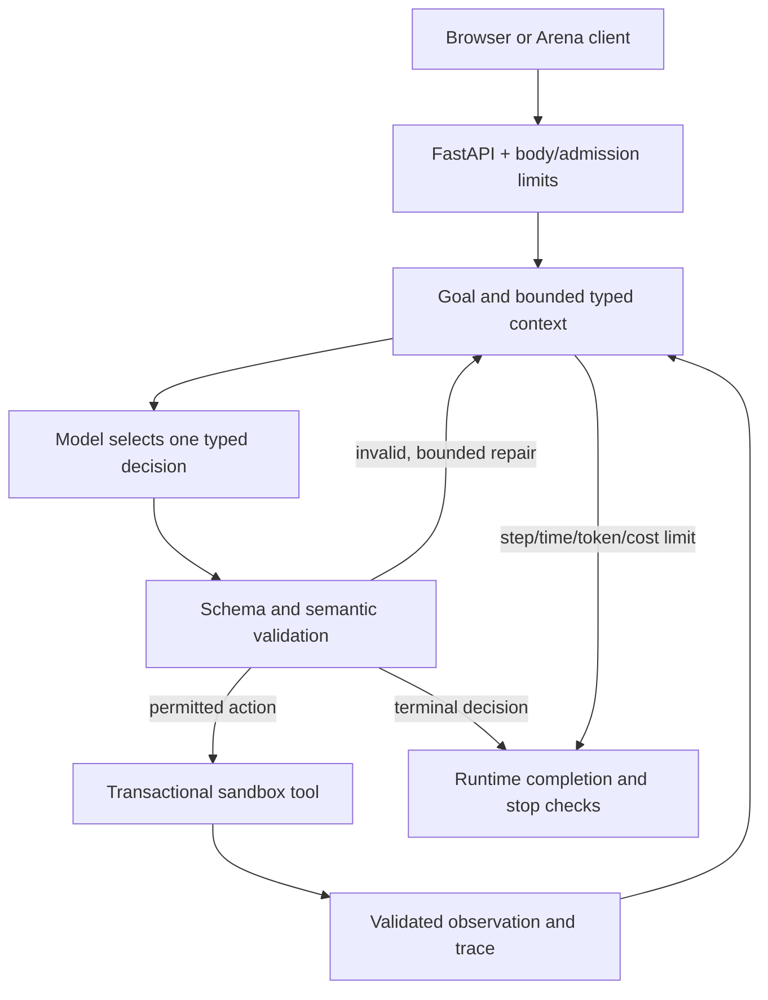

# TicketPilot - Agent Arena

**Eraj Zaman | i221296 | Agentic AI, Assignment 1**

TicketPilot reads one sample support ticket, chooses a policy-compliant priority and
team, and prepares an unsent reply draft. The model chooses actions and reply content;
Python owns validation, permitted capabilities, retries and stopping.

> **Readiness:** the local application and offline tests are implemented. Real-model
> measurements, public deployment, private GitHub access and Classroom submission
> still require account configuration. The default `demo` is a deterministic UI/test
> aid, not an LLM and not evidence of satisfying the model-selection requirement.

## Quick start

Use Python 3.12 or newer. From the extracted `i221296` folder:

```powershell
python -m venv .venv
.\.venv\Scripts\python.exe -m pip install -r requirements.txt
Copy-Item .env.example .env
.\.venv\Scripts\python.exe run.py
```

On macOS/Linux, replace the interpreter paths with `python3` and
`.venv/bin/python`; use `cp .env.example .env`. Open
http://127.0.0.1:8000/ or http://127.0.0.1:8000/docs.
No API key is needed for the explicitly labelled offline demo. Try
`Triage T1001`, or `Triage ticket` followed by `T1001`.
A sample-queue button fills the input; press Run triage to execute.

## Agent Design Canvas

| Element | Design |
|---|---|
| Operational goal | Triage one existing sandbox support ticket and prepare a reply for human review. |
| Completion condition | Successful read_ticket, validated set_triage, and draft_reply with sent=false, followed by a valid completed decision. |
| System boundary | FastAPI, ten synthetic tickets, a per-run in-memory sandbox, and a configured external model API. No real help-desk, email, refund or account integration. |
| Observations | Current user request, bounded typed chat history, pending user goal, ticket data, trusted routing policy, validation feedback and tool results. |
| Actions/tools | read_ticket, read_policy, set_triage, draft_reply. |
| State | Active goal, authorized ticket IDs, loaded ticket, triage, draft, decision count, policy flag, fault flag, observations, traces, errors and usage. |
| Autonomy boundary | May read sample records and create sandbox triage/drafts. Cannot send messages, delete files, issue refunds, change accounts, run code or call arbitrary URLs. |
| Primary risks | Injection in customer text, invented IDs, invalid routing, false completion, provider/tool failures, runaway calls, session leakage and unbounded input. |
| Evaluation criteria | Correct ticket/team/priority and unsent draft; six Arena stress categories; isolation and multi-turn clarification; bounded latency/calls; measured model validity and cost. |

The approved domain is **Support-Ticket Triage**. No custom-domain approval is needed.
All sample people/accounts are synthetic; no customer PII is used.

## Architecture



The live agent can choose whether to inspect policy, how to classify permitted
priorities, what draft to write, whether to clarify, and whether to stop. Actions
depend on observations and validated decisions rather than a fixed function chain.
The offline demo is intentionally scripted and must not be presented as this live loop.

### Folder map

```text
i221296/
  app/
    main.py          FastAPI composition
    api.py           HTTP routes, session handoff, model allowlist
    config.py        environment configuration and bounded settings
    models.py        common Arena and domain contracts
    domain.py        trusted routing/priority policy and goal resolution
    prompts.py       dynamic system/context assembly
    providers.py     Gemini/Anthropic REST adapters + labelled demo
    agent.py         model-driven loop and shared decision budget
    tools.py         capability gateway and transactional sandbox
    arena.py         validated response boundary and safe summary logging
    memory.py        bounded typed messages and pending clarification goal
    limits.py        body, admission and rate bounds
    static/          browser interface
  data/sample_data.json
  evaluation/
    public_cases.json
    model_cases.json
    checks.py
    run_public_tests.py
    compare_models.py
    verify_deployment.py
    results/         actual recorded evidence, labelled by execution mode
  tests/
  scripts/package_submission.py
  SUBMISSION.md
  submission_details.json
  requirements.txt
  .env.example
  .gitignore
  render.yaml
  Dockerfile
  run.py
```

## Tools, schemas and validation

| Tool | Input | Output and constraints |
|---|---|---|
| read_ticket | ticket_id matching T plus four digits | Known sample Ticket; ID must come from exactly one active user goal. |
| read_policy | Empty object | Trusted routing and priority policy. Optional model-selected lookup. |
| set_triage | ticket_id, priority, team, rationale | A Triage record; ticket must already be loaded; team must follow trusted category/security facts; priority cannot fall below its floor. |
| draft_reply | ticket_id, text | Draft with sent=false; valid triage must exist first. No sending capability. |

Decision schema: status is continue, needs_clarification, completed, blocked or
failed; action is one of the four registered tools or null; arguments is an object;
user_message is optional bounded text. Pydantic rejects unknown fields. Tool input
and output validation is strict. Terminal decisions cannot contain an executable
action. A continuation requires an action and valid typed arguments.

Team mapping: billing -> billing; technical -> engineering; account ->
account_support; general -> general_support. A security-risk flag overrides the
category and requires security. Security risk or an all-users outage requires urgent.
Other outages or team-wide impact require at least high. Ordinary individual
issues allow low or normal (the model may choose a higher priority).

Structured sample metadata is trusted application data; ticket subject/body and
external notes are untrusted text. A model cannot lower the priority floor or
change the team policy using text instructions. Tool results are validated and
checked against their expected record before committing state. A failed attempt
cannot save a partial triage or duplicate a draft.

Completed output is rendered from validated state. Model claims of completion
without all three required successful tools are rejected. Draft factual quality
still needs live evaluation and human review; the system prevents real sending,
not every possible inaccurate sentence in a draft.

## Prompt and context design

The static SYSTEM layer contains the authority boundary, tool policy, schema and
trusted routing rules. The dynamic USER payload is a JSON object with distinct
active_user_goal, conversation_history, runtime_state,
external_untrusted_content and tool_and_validation_observations fields.

External text is never inserted into the system message. Structured encoding stops
text from breaking field boundaries; policy and validation prevent it from granting
capabilities. There is no blacklist of injection phrases and no hard-coded Arena
example response. General ticket-ID syntax is parsed from the user goal, never from
external notes or tool text. Multiple/unknown IDs require clarification.

Only brief operational evidence is logged; private chain-of-thought is not requested.
Server logs contain request ID, outcome, decision count and stop reason, not prompts,
keys or raw provider errors. UI observations contain only synthetic sample data.

## Conversation memory

Each chat uses a browser-generated UUID. Typed user/assistant messages are bounded to
12 messages (six turns) and 24,000 characters; oldest complete pairs are removed.
The session store holds at most 100 sessions. These limits are configurable.

A pending clarification goal is kept separately from history, so a bare identifier
such as T1001 resumes “Triage ticket”. An explicit new task replaces the pending goal.
A clarification selecting a new ID replaces previous ID selections. Broader follow-up
interpretation is limited: arbitrary non-ID answers are treated as a new user goal.
Users can always issue an explicit new request.

New chat clears server history and changes the session ID; reloading generates a
new session. Each run receives a fresh sandbox. Triage/drafts are not persistent;
prior results remain only in bounded chat text. Separate sessions cannot share
sandbox state. Arena request_id is correlation only and never a memory key.

History and rate/call counters are in-memory: use **one worker**. Restarts clear them.
Session IDs are unguessable identifiers, not a production authentication system;
only synthetic data is suitable for this public demonstration.

## Bounded execution and cost

Defaults: six total model decisions, two contract repairs, two tool retries (three
attempts), 40-second run timeout, 15-second provider timeout, two-second tool timeout,
1,024 maximum output tokens, 60,000 conservative run tokens, and 32,000 context bytes.
All repair and provider retry decisions share the six-step budget. Tool retries
reuse the same validated decision and do not consume another model decision.

The provider output-token cap is sent on every model request. The runtime reserves
one token per UTF-8 prompt byte plus protocol overhead and output allowance before
a call; known provider usage replaces that reservation afterwards. Unknown usage
retains the conservative reservation and public usage/cost stays null. Gemini
reported thinking tokens are included with output usage.

If per-model prices are configured, a USD 0.05 default per-run budget is enforced
conservatively before calls. Without prices, dollar estimation/enforcement is
unavailable; step/token/call limits still apply. Prices are not invented.

Public admission defaults: two simultaneous runs globally, 30 requests per minute
globally, one request per chat, 240,000-byte HTTP body limit, and 200 live model
calls per UTC day per process. Provider attempts, including failures, consume the
daily allowance. Provider account spending limits are also recommended because
process-local limits reset on restart and cannot enforce account-wide spend.

Run status includes completed, needs_clarification, blocked, tool_error,
contract_error, budget_exceeded and failed. approval_required is preserved by the
common HTTP schema, but this agent blocks consequential actions instead of offering
a real-action approval flow. Stop reasons identify the specific budget or error.

## Arena interface and fault injection

- GET /health - availability, configured model and demo/live mode.
- GET /arena/manifest - common version, actions, fault types and limits.
- POST /arena/run - independent evaluation run using the default model.
- POST /chat - session_id plus model and Arena request fields.
- DELETE /chat/{session_id} - reset one idle chat.
- GET /models - configured allowed model IDs; never credentials.
- GET /docs - interactive FastAPI API documentation.

```json
{
  "task": "Triage T1001",
  "external_context": [],
  "arena_config": {"max_steps": 6, "fault": "none"}
}
```

Preserved response fields: arena_version, request_id, status, final_response, steps,
stop_reason, tool_calls, errors, events and metrics. Responses are bounded to 50,000
bytes and final_response to 2,000 characters.

Faults: none; tool_timeout; malformed_tool_output; invalid_agent_decision. Shorthand
strings and expanded {"type":"tool_timeout"} are accepted. Each fault affects the
first matching operation once per run. Tool faults occur before commit; invalid
decision injection occurs after the model call and still charges its step/usage.
No fault is “consumed” before a matching operation.

## Tests and recorded evidence

```powershell
.\.venv\Scripts\python.exe -m unittest discover -s tests -v
.\.venv\Scripts\python.exe evaluation/run_public_tests.py --url http://127.0.0.1:8000
```

Unit tests use scripted decisions and mocked HTTP providers, with no paid API calls.
They cover all six stress categories, semantic policy violations, isolated sessions,
clarification, response contracts, bounded recovery, context/token/cost/time limits,
provider serialization and sanitized failures.

Public tests include successful triage, missing/unknown/conflicting IDs, injected
text, each fault hook, budget exhaustion, autonomy and a two-turn chat. The public
runner checks structured observations and state, not just a success label.

The current evidence records **49/49 unit tests** and **14/14 local HTTP checks**.
See evaluation/results/local_unit_results.txt and local_public_results.json for
actual offline evidence. These results **do not establish live LLM injection
resistance, language understanding, model quality or the hidden Arena score**.

## Live provider setup and required model experiment

Provider adapters use async REST via httpx. Supported providers are Gemini and
Anthropic. Obtain access through your own account; keep the key only in .env or the
host secret settings. No key was supplied with this project.

Set MODEL_PROVIDER, MODEL_NAME, and comma-separated MODEL_NAMES to two exact enabled
model IDs available to your account. Set GEMINI_API_KEY or ANTHROPIC_API_KEY.
Set ENABLE_DEMO=false for evaluation. Do not use an unverified model alias.

MODEL_PRICES_JSON is a JSON object mapping exact model IDs to input/output USD per
million tokens. Example shape (replace symbolic values with current numeric prices):
{"model-a":{"input":INPUT_PRICE,"output":OUTPUT_PRICE}}.
Model availability and prices must be checked with the provider before running.

```powershell
.\.venv\Scripts\python.exe evaluation/compare_models.py --models MODEL_A MODEL_B
```

The runner refuses demo and identical model IDs. It runs the same ten representative
tasks through the complete loop, saves every outcome, and reports task success,
decision contract validity, action-selection success, mean latency, tokens and cost.
Intentional invalid-decision injection affects the reported contract-validity rate;
inspect per-case data to distinguish that forced error from natural model errors.
“Correct action selection” is a strict end-to-end expected-action/state pass metric,
not an independent human judgment of each intermediate action.

| Candidate | Task success | Contract validity | Action selection | Latency | Tokens | Estimated cost |
|---|---|---|---|---|---|---|
| Live model A - not configured | Not measured | Not measured | Not measured | Not measured | Not measured | Not measured |
| Live model B - not configured | Not measured | Not measured | Not measured | Not measured | Not measured | Not measured |

**Selection rationale pending real measurements.** Prefer the model meeting semantic
correctness and safety requirements first, then compare validity, latency and cost.
A model with more failures cannot be selected solely for lower cost. Both must fit
the bounded context/output and 40-second loop budget. Copy measured results into
this table and write the observed tradeoff before final submission.

## Deployment

Render is the supplied deployment target. Create a **private** GitHub repository
from this source folder and invite the instructor using the verified Classroom
username. Do not invite an inferred username or make the repository public.

Use the Render Python service configuration in render.yaml:
build `pip install -r requirements.txt`;
start `uvicorn app.main:app --host 0.0.0.0 --port $PORT --workers 1`;
health route /health. Set the provider/model settings and secret key in Render.
For Anthropic, replace the Gemini secret field with ANTHROPIC_API_KEY.
The Dockerfile offers an equivalent startup path.

The local default host is 127.0.0.1; hosted startup binds 0.0.0.0 and uses PORT.
Use ENABLE_DEMO=false and a live default model for grading. A healthy process alone
does not prove the provider is working. Free hosts may sleep or restart; do not
promise availability that has not been measured.

After deployment, from outside the hosting environment:

```powershell
.\.venv\Scripts\python.exe evaluation/verify_deployment.py --url https://YOUR-PUBLIC-HOST
.\.venv\Scripts\python.exe evaluation/run_public_tests.py --url https://YOUR-PUBLIC-HOST --output evaluation/results/deployed_public_results.json
```

Verify the browser UI in a private window. The required APIs and app must require
neither evaluator login nor an evaluator-supplied key. Opening the POST endpoint in
the address bar is not a valid POST test.

Provider API references:
- https://ai.google.dev/api/generate-content
- https://ai.google.dev/gemini-api/docs/structured-output
- https://platform.claude.com/docs/en/api/messages
- https://render.com/docs/deploy-fastapi

## Submission and remaining external requirements

The two Classroom attachments are **i221296.zip** and
**i221296_submission.pdf**. ZIP contents must have one top-level i221296 folder.
SUBMISSION.md and the PDF must match submission_details.json and contain the same
full source commit hash and actual URLs.

The supplied summaries are labelled draft because class/section, university email,
verified GitHub identity, instructor username, repository access, public deployment
and real-model measurements have not been supplied or completed. Required deployment
URLs are explicitly marked pending rather than replaced with localhost links.

The source commit can precede metadata generation, as permitted by the starter.
Do not claim the draft metadata is deployment verification. Complete the live
experiment, documentation and deployment, commit final source, then regenerate
metadata and package that exact source version. Regenerate matching summaries with `pip install -r requirements-docs.txt` then
`python scripts/build_submission.py`. The packaging script requires
explicit --draft for incomplete metadata and checks the declared source hash.

```powershell
.\.venv\Scripts\python.exe scripts/package_submission.py --draft
```

Exclude secrets, real .env, virtual environments, .git, caches, node_modules and
unnecessary logs. Test the extracted archive using the documented instructions.
Upload both files to Classroom, click Turn in, confirm Turned in, and keep the
submitted source/deployment available during the evaluation window. The live
Classroom deadline takes precedence over the September 24, 2026 date printed in
the supplied assignment PDF.
